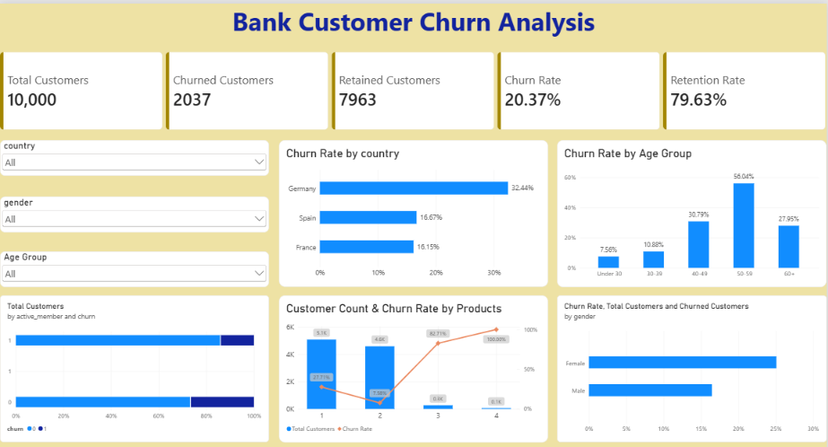

# Bank Customer Churn Analysis

## Project Overview

This project analyzes bank customer data to understand customer churn, identify patterns associated with customer attrition, and uncover insights that can support customer retention strategies.

The project follows an end-to-end data analytics workflow using Python, PostgreSQL, and Power BI.

## Business Objectives

- Calculate the overall customer churn rate.
- Identify customer segments with higher churn rates.
- Analyze churn across different age groups, countries, and genders.
- Understand the relationship between customer activity and churn.
- Examine customer financial and banking characteristics.
- Generate insights to support customer retention strategies.

## Dataset Description

The dataset contains 10,000 customer records with demographic, financial, and banking information.

| Column | Description |
|---|---|
| customer_id | Unique customer identifier |
| credit_score | Customer credit score |
| country | Customer's country |
| gender | Customer gender |
| age | Customer age |
| tenure | Duration of relationship with the bank |
| balance | Bank account balance |
| products_number | Number of banking products used |
| credit_card | Credit card ownership status |
| active_member | Customer activity status |
| estimated_salary | Estimated customer salary |
| churn | Customer churn status (0 or 1) |

## Tools & Technologies

| Tool | Purpose |
|---|---|
| Python | Data profiling and validation |
| Pandas & NumPy | Data exploration |
| PostgreSQL | SQL-based exploratory data analysis |
| Power BI | Interactive dashboard development |
| DAX | Calculated columns and KPI measures |

## Project Workflow

### 1. Data Profiling & Validation — Python

- Examined dataset structure and data types.
- Checked for missing values and duplicate records.
- Validated customer identifiers and categorical values.
- Explored the distribution of customer attributes.

The original dataset was retained after validation, as no additional cleaning was required.

### 2. Exploratory Data Analysis — PostgreSQL

- Imported the dataset into PostgreSQL.
- Analyzed overall customer churn.
- Explored churn across demographic and banking attributes.
- Compared churned and retained customer segments.
- Used SQL aggregations and conditional calculations to investigate churn patterns.

### 3. Data Visualization — Power BI

- Developed an interactive customer churn dashboard.
- Created DAX measures for key performance indicators.
- Created age groups for customer segmentation.
- Implemented interactive slicers for customer-level analysis.
- Visualized customer churn patterns and banking behavior.

## Dashboard Preview

### Key Performance Indicators

- Total Customers
- Total Churned Customers
- Churn Rate (%)
- Active Members (%)

### Key Analysis Areas

- Churn by country
- Churn by gender
- Churn by age group
- Customer activity and churn
- Account balance and churn

### Interactive Filters

- Country
- Gender
- Active member status

## DAX & Data Modeling

DAX was used to create calculated columns and measures for:

- Total customer count
- Churned customer count
- Customer churn rate
- Active member percentage
- Average account balance
- Age group segmentation
- Age group sorting

## Business Applications

This analysis can help banking organizations:

- Identify customer segments with higher churn rates.
- Understand customer engagement patterns.
- Prioritize customer retention initiatives.
- Monitor customer attrition through interactive reporting.
- Support data-driven customer relationship management.

## Repository Structure

| Folder / File | Description |
|---|---|
| Dataset/ | Original customer churn dataset |
| Python/ | Data profiling and validation script |
| SQL/ | Exploratory data analysis queries |
| PowerBI/ | Interactive Power BI dashboard |
| Screenshots/ | Dashboard preview |
| README.md | Project documentation |

## How to Use

1. Download the dataset from the Dataset folder.
2. Run the Python script to explore and validate the data.
3. Import the dataset into PostgreSQL and execute the SQL queries.
4. Open the Power BI dashboard using Power BI Desktop.
5. Explore customer churn patterns using interactive filters.

## Conclusion

This project demonstrates an end-to-end data analytics workflow, from data validation and SQL-based exploration to interactive business intelligence reporting. It provides a structured approach to understanding customer churn and supporting customer retention decisions.

## Skills Demonstrated

Python · Pandas · NumPy · PostgreSQL · SQL · Power BI · DAX · Exploratory Data Analysis · Customer Segmentation · KPI Reporting · Business Intelligence
